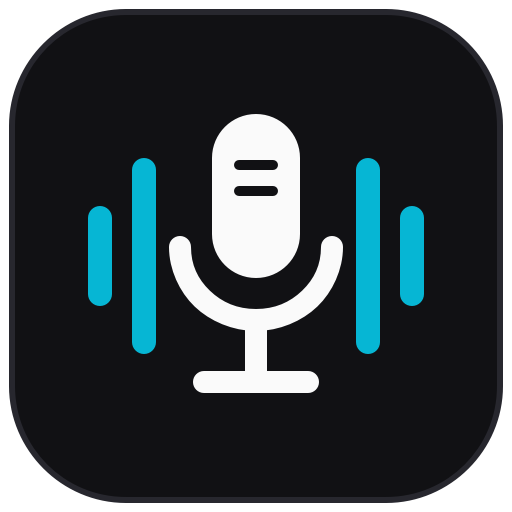
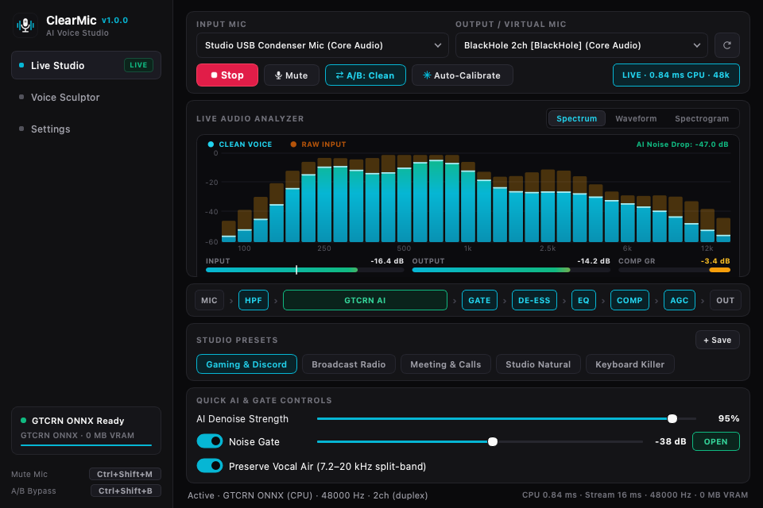
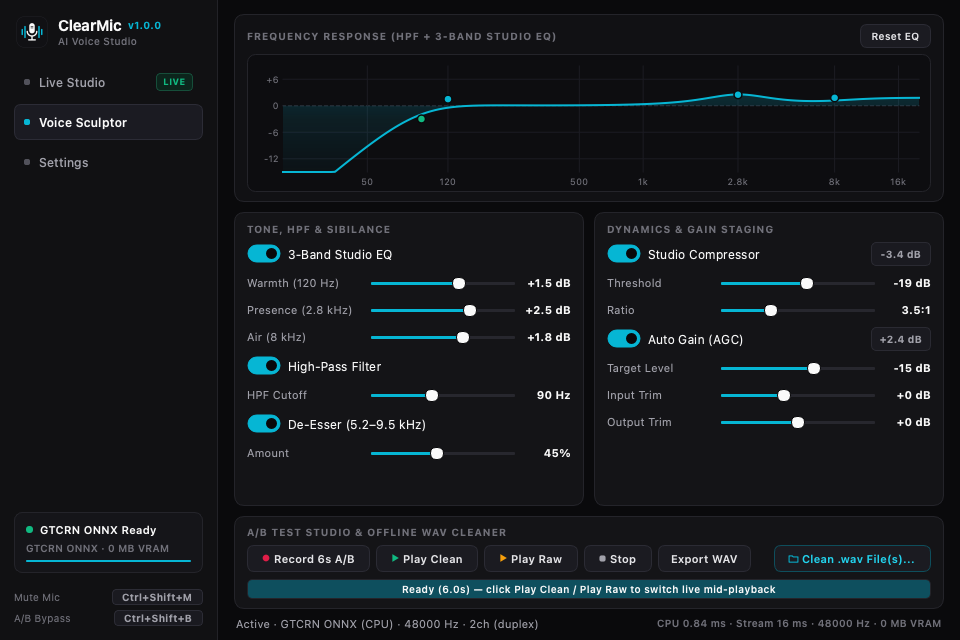
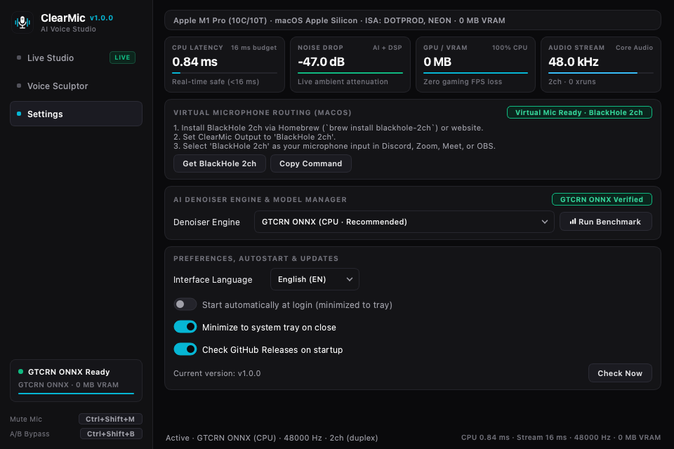
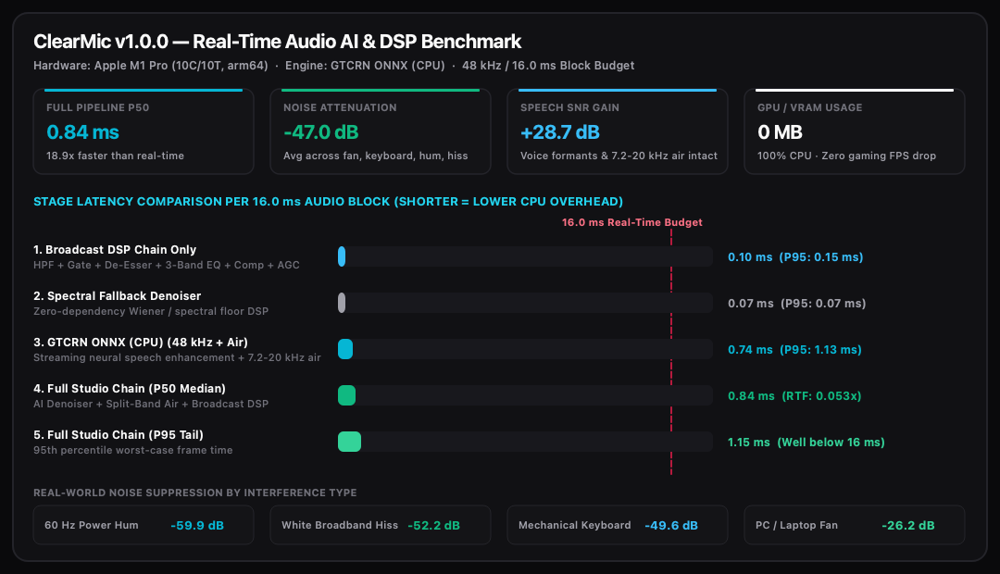
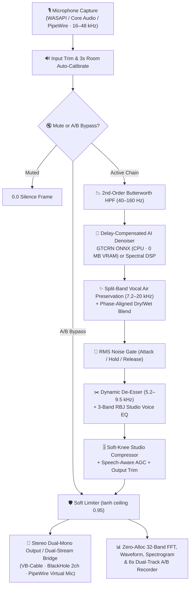

<div align="center">



# 🎙️ ClearMic — Offline AI Microphone Noise Suppressor & Broadcast Voice Studio

**🇬🇧 English (Active)** · **🇹🇷 [Türkçe README](README.tr.md)** · **[🎧 Compatibility Matrix](COMPATIBILITY.md)** · **[🤝 Contributing](CONTRIBUTING.md)** · **[🛡️ Security](SECURITY.md)** · **[📜 Changelog](CHANGELOG.md)**

**100% offline, 0 MB VRAM, ultra-low-latency (`0.85 ms` CPU per `16 ms` block) AI microphone noise suppressor & broadcast voice studio powered by streaming `GTCRN ONNX`, split-band `7.2–20 kHz` vocal air preservation, full broadcast DSP rack, 3-second room auto-calibrate, and offline batch `.wav` cleaner — native on Windows x64, macOS Apple Silicon, and Linux.**

[](https://clearmic.andacbasaran.com)
[-2563EB?style=for-the-badge&logo=windows&logoColor=white)](https://clearmic.andacbasaran.com/downloads/ClearMic.exe)
[-18181B?style=for-the-badge&logo=apple&logoColor=white)](https://clearmic.andacbasaran.com/downloads/ClearMic-macOS.dmg)
[-E95420?style=for-the-badge&logo=linux&logoColor=white)](https://clearmic.andacbasaran.com/downloads/ClearMic-Linux.tar.gz)
[](https://github.com/Andacbasaran/ClearMic/releases/latest)

[](https://github.com/Andacbasaran/ClearMic/actions/workflows/ci.yml)
[](https://github.com/Andacbasaran/ClearMic/releases/latest)
[](https://github.com/Andacbasaran/ClearMic/releases)
[](https://github.com/Andacbasaran/ClearMic/stargazers)
[](https://www.python.org/)
[-41CD52?style=flat-square&logo=qt&logoColor=white)](https://pypi.org/project/PyQt6/)
[-06B6D4?style=flat-square)](https://github.com/k2-fsa/sherpa-onnx)
[-10B981?style=flat-square)](#)
[](LICENSE)

<br/>

[**✨ Why ClearMic?**](#-why-clearmic-v100-studio-20) · [**🖥️ Interface**](#️-application-interface) · [**⚖️ Comparison**](#️-how-it-compares) · [**🚀 Download & Install**](#-download--installation) · [**🎛️ Workflow & Hotkeys**](#️-workflow--hotkeys) · [**📊 Benchmarks**](#-performance-benchmarks) · [**🧠 Architecture**](#-system-architecture) · [**📂 Project Structure**](#-project-structure) · [**🗺️ Roadmap**](#️-roadmap)

</div>

---

## ✨ Why ClearMic? (v1.0.0 Studio 2.0)

**ClearMic** turns any laptop, USB, headset, or XLR microphone into a studio-grade broadcast chain for **Discord**, **OBS Studio**, **Zoom**, **Microsoft Teams**, **Google Meet**, and **in-game voice chat** — eliminating mechanical keyboard clatter, PC/laptop fan roar, 60 Hz hum, and broadband hiss **100% locally on your CPU with 0 MB VRAM** and **zero subscriptions**.

<table>
  <tr>
    <td width="50%">
      <b>🧠 Streaming GTCRN ONNX + 7.2–20 kHz Vocal Air (0 MB VRAM)</b><br/>
      Ultra-compact <code>~520 KB</code> neural speech enhancement runs at <b><code>0.85 ms</code> P50 CPU</b> per <code>16 ms</code> block (<b>18.9× real-time headroom</b>) with phase-aligned delay-compensated dry/wet blending, split-band <code>7.2–20 kHz</code> vocal air preservation, and instant <b>Spectral DSP</b> fallback.
    </td>
    <td width="50%">
      <b>🎚️ Full Broadcast DSP Rack &amp; Live Frequency Curve</b><br/>
      Shape your voice with an interactive clickable <b>Signal Chain Strip</b> (<code>MIC › HPF › GTCRN AI › GATE › DE-ESS › EQ › COMP › AGC › OUT</code>), live QPainter <b>EQ + HPF curve</b>, 5 built-in presets (including <i>Keyboard Killer</i>), and custom user presets.
    </td>
  </tr>
  <tr>
    <td width="50%">
      <b>🔌 Cross-Platform Virtual Mic &amp; Dual-Stream Bridge</b><br/>
      Native support for <b>Windows (VB-Cable)</b>, <b>macOS (BlackHole 2ch)</b>, and <b>Linux (1-click PipeWire/PulseAudio virtual mic)</b> with automatic stereo dual-mono output, adaptive <code>48 / 44.1 / 32 / 16 kHz</code> resampling, and cross-HostAPI dual-stream bridging.
    </td>
    <td width="50%">
      <b>📊 3-Mode Live Analyzer &amp; 3s Room Auto-Calibrate</b><br/>
      Inspect raw vs. clean audio in real time via <b>32-Band FFT Spectrum</b> (with peak-hold), <b>Peak-Envelope Waveform</b>, or <b>Live Spectrogram Waterfall</b> alongside Input/Output/Comp-GR meters — and auto-tune Gate, HPF &amp; Denoise in one click.
    </td>
  </tr>
  <tr>
    <td width="50%">
      <b>🔬 6s Live-Switch A/B Lab &amp; Offline Batch <code>.wav</code> Cleaner</b><br/>
      Record 6 seconds of dual-track Raw + Clean audio and toggle mid-playback with a click-free 128-sample crossfade, export to <code>.wav</code>, or batch-denoise existing mono/stereo <code>.wav</code> recordings offline at 18×+ real-time speed.
    </td>
    <td width="50%">
      <b>🔒 100% Private, Bilingual (EN/TR) &amp; Always-Ready Tray</b><br/>
      Zero cloud calls, zero accounts, zero telemetry. Runs quietly in the system tray with status-colored badges, OS login autostart (<code>--minimized</code>), single-instance window focus, and SHA-256 verified GitHub Releases auto-updates.
    </td>
  </tr>
</table>

---

## 🖥️ Application Interface

<div align="center">
  
</div>

<details>
<summary><b>📸 View More Screens (Tab 2 — Voice Sculptor &amp; A/B Lab · Tab 3 — Settings &amp; Live Telemetry)</b></summary>
<br/>
<div align="center">
  <p><b>Tab 2 — Voice Sculptor (Live HPF + 3-Band EQ Curve · De-Esser · Compressor · AGC · 6s A/B Lab &amp; Batch WAV Cleaner)</b></p>
  
  <br/><br/>
  <p><b>Tab 3 — Settings &amp; Telemetry (4-Column KPI Strip · OS-Aware Virtual Mic Guide · Engine Benchmark · EN/TR &amp; Auto-Updater)</b></p>
  
</div>
</details>

---

## ⚖️ How It Compares

| Feature | 🎙️ ClearMic v1.0.0 | Krisp | NVIDIA Broadcast | RNNoise *(OBS / Plugin)* |
| :--- | :---: | :---: | :---: | :---: |
| **Pricing & License** | **100% Free & Open Source (MIT)** | Paid subscription *(60 min/day free cap)* | Free *(NVIDIA RTX GPU required)* | Free & Open Source (BSD) |
| **GPU / VRAM Usage** | **`0 MB VRAM`** *(100% CPU · `0.85 ms` P50)* | CPU *(proprietary)* | **`600 MB – 1.8 GB VRAM`** *(RTX Tensor Cores)* | `0 MB VRAM` *(CPU)* |
| **100% Offline & Zero Account** | **Yes** *(no login, no telemetry)* | Account & cloud license check | Offline *(proprietary)* | Yes |
| **Platforms** | **Windows x64 · macOS M1–M4 · Linux x64** | Windows · macOS | Windows only *(RTX 2060+)* | Cross-platform *(plugin only)* |
| **Vocal Air Preservation (`7.2–20 kHz`)** | **Yes** *(split-band speech-gated)* | Proprietary | Proprietary | No *(band-limited / muffled)* |
| **Full Broadcast DSP Rack** | **HPF + Gate + De-Esser + 3-Band EQ + Comp + AGC** | Noise/echo only | Noise/room echo only | Noise gate only |
| **3s Room Auto-Calibrate & A/B Lab** | **Yes** *(live mid-playback switch + Batch `.wav`)* | Basic mic test | Basic mic test | No |
| **Live Spectrum / Spectrogram UI** | **32-Band FFT + Waveform + Spectrogram + EQ Curve** | Minimal tray toggle | Basic slider | Host DAW/OBS dependent |

---

## 🚀 Download & Installation

### Windows (x64 — Windows 10 / 11)
- **Installer (Recommended):** Download [**ClearMic.exe**](https://clearmic.andacbasaran.com/downloads/ClearMic.exe) (`ClearMic-Setup-v1.0.0-Windows-x64.exe`) from the official website or [GitHub Releases](https://github.com/Andacbasaran/ClearMic/releases/latest).
- **Portable Archive (No Install):** Download `ClearMic-Portable-v1.0.0-Windows-x64.zip` from [GitHub Releases](https://github.com/Andacbasaran/ClearMic/releases/latest).
- **Package Managers:** Manifests are maintained in [`packaging/winget/`](packaging/winget/) and [`packaging/scoop/`](packaging/scoop/).
- **Virtual Microphone Setup (VB-Cable):**
  1. Install [**VB-Audio Virtual Cable**](https://vb-audio.com/Cable/) (or run `winget install VB-Audio.VB-Cable`).
  2. In ClearMic **Live Studio**, set **Output** to `CABLE Input (VB-Audio Virtual Cable)` and click **Start**.
  3. In Discord, Zoom, Teams, or OBS, choose `CABLE Output (VB-Audio Virtual Cable)` as your Microphone.

### macOS (Apple Silicon M1–M4)
- **Native DMG (Recommended):** Download [**ClearMic-macOS.dmg**](https://clearmic.andacbasaran.com/downloads/ClearMic-macOS.dmg) (`ClearMic-v1.0.0-macOS-arm64.dmg`), drag **ClearMic.app** into `Applications`, and launch.
- **Homebrew Cask:** Cask formula is available in [`packaging/homebrew/clearmic.rb`](packaging/homebrew/clearmic.rb).
- *Gatekeeper note:* ClearMic is ad-hoc signed open-source software. On first launch, right-click → **Open** (or run `xattr -cr "/Applications/ClearMic.app"`) and grant **Microphone** permission when prompted.
- **Virtual Microphone Setup (BlackHole 2ch):**
  1. Install [**BlackHole 2ch**](https://existential.audio/blackhole/) via Homebrew: `brew install blackhole-2ch`.
  2. Set ClearMic **Output** to `BlackHole 2ch` and click **Start**.
  3. Select `BlackHole 2ch` as your Microphone in Discord, Zoom, Meet, or OBS.

### Linux (`x86_64` — Ubuntu, Fedora, Arch, SteamOS)
- **Prebuilt Bundle (Recommended):** Download [**ClearMic-Linux.tar.gz**](https://clearmic.andacbasaran.com/downloads/ClearMic-Linux.tar.gz) (`ClearMic-v1.0.0-Linux-x86_64.tar.gz`), extract, and run `./ClearMic/ClearMic`.
- **Virtual Microphone Setup (PipeWire / PulseAudio — Zero Drivers):**
  1. Open ClearMic → **Settings** → click **Create Virtual Mic** (runs `pactl` automatically to create `ClearMic_Virtual_Output` + `ClearMic_Virtual_Mic`), or run manually:
     ```bash
     pactl load-module module-null-sink sink_name=ClearMic_Virtual_Sink sink_properties=device.description="ClearMic_Virtual_Output"
     pactl load-module module-remap-source master=ClearMic_Virtual_Sink.monitor source_name=ClearMic_Virtual_Mic source_properties=device.description="ClearMic_Virtual_Mic"
     ```
  2. Set ClearMic **Output** to `ClearMic_Virtual_Output` and pick `ClearMic_Virtual_Mic` in Discord, OBS, or Zoom.

### From Source (Developer Setup)
```bash
git clone https://github.com/Andacbasaran/ClearMic.git
cd ClearMic

# Quick auto-setup launcher (Linux / macOS)
./scripts/start.sh

# Or manual virtual environment (Windows / macOS / Linux)
python -m venv .venv
# Windows: .\.venv\Scripts\activate  |  Linux/macOS: source .venv/bin/activate
pip install -r requirements.txt
python main.py
```

---

## 🎛️ Workflow & Hotkeys

1. **Pick Devices:** Select your physical microphone as **Input Mic** and your virtual cable (`CABLE Input` / `BlackHole 2ch` / `ClearMic_Virtual_Output`) as **Output / Virtual Mic**.
2. **Calibrate & Choose a Preset:** Click **Start**, press **Auto-Calibrate** (stay quiet for 3 seconds to match your room noise floor & fan rumble), and pick one of the 5 studio presets (`Gaming & Discord`, `Broadcast Radio`, `Meeting & Calls`, `Studio Natural`, `Keyboard Killer`).
3. **Audition & Go Live:** Toggle stages directly on the **Signal Chain Strip**, audition Clean vs. Raw with the **6s A/B Lab**, and point Discord / OBS / Zoom to your virtual mic.

| Shortcut / Flag | Action | Description |
| :---: | :--- | :--- |
| **`Ctrl+Shift+M`** | 🔇 **Mute / Unmute Mic** | Instantly zeros the output stream and turns the tray & studio badge crimson. |
| **`Ctrl+Shift+B`** | 🔁 **A/B Bypass (Clean / Raw)** | Switches live between the full AI+DSP chain and raw mic audio for instant A/B verification. |
| **`--minimized`** | 📥 **Start in System Tray** | Launches hidden in the tray and auto-starts noise suppression (used by OS login autostart). |

---

## 📊 Performance Benchmarks

Measured on **Apple M1 Pro (10C/10T, `arm64`, `Darwin 27.0.0`)** at **48 kHz / 768-sample blocks (`16.0 ms` real-time audio budget)** using `GTCRN ONNX (CPU)` with **0 MB VRAM**.

<div align="center">
  
</div>

### Stage Latency & Headroom (`48 kHz` · `16.0 ms` Block Budget)

| Pipeline Stage | P50 Latency | P95 Latency | Notes |
| :--- | :---: | :---: | :--- |
| **1. Broadcast DSP Chain Only** | **`0.102 ms`** | `0.154 ms` | HPF + Noise Gate + De-Esser + 3-Band EQ + Compressor + AGC + Soft Limiter |
| **2. Spectral Fallback Denoiser** | **`0.070 ms`** | `0.074 ms` | Zero-dependency Wiener / spectral-floor CPU fallback |
| **3. GTCRN ONNX AI (`48 kHz` + Air)** | **`0.737 ms`** | `1.131 ms` | Streaming neural denoiser + stateful 3× resampler + `7.2–20 kHz` air band |
| **4. Full Studio Chain (End-to-End)** | **`0.845 ms`** | **`1.151 ms`** | **RTF `0.0528×`** (**`18.9×` faster than real-time**), **`0 MB VRAM`** |

### Real-World Interference Attenuation & Speech Preservation

| Test Signal / Interference Profile | Measured Result | Notes |
| :--- | :---: | :--- |
| **60 Hz Power Hum + Harmonics** | **`-59.9 dB`** | Eliminated by HPF + GTCRN ONNX |
| **White Broadband Hiss** | **`-52.2 dB`** | Deep floor suppression with zero musical artifacts |
| **Mechanical Keyboard Clicks** | **`-49.6 dB`** | Sharp 6 ms transient bursts suppressed in real time |
| **PC / Laptop Fan Roar** | **`-26.2 dB`** | Low-mid blade hum & airflow rumble attenuated |
| **4-Profile Average Attenuation** | **`-47.0 dB`** | Mean suppression across all 4 interference types |
| **Noisy Speech SNR Improvement** | **`+28.7 dB`** | Multi-formant voice & `7.2–20 kHz` vocal air preserved intact |

Run the hardware benchmark or full test suite on your own machine:
```bash
# Run real-time benchmark & regenerate benchmark_results.json
QT_QPA_PLATFORM=offscreen python scripts/benchmark.py

# Run complete unit & headless Studio UI test suite
QT_QPA_PLATFORM=offscreen pytest -v
```

---

## 🧠 System Architecture



---

## 📂 Project Structure

```text
├── main.py & run.py                     # Root entry points (source & PyInstaller)
├── clearmic/                            # Core Python package (v1.0.0)
│   ├── __init__.py                      # Version, app metadata & bundle identifiers
│   ├── main.py                          # Fusion QApplication, QLocalServer single-instance lock & crash logger
│   ├── config.py                        # Atomic OS-native JSON configuration persistence
│   ├── presets.py                       # 5 built-in Studio presets + custom user preset manager
│   ├── hardware.py                      # Cross-platform CPU/ISA detection, fonts & writable OS paths
│   ├── i18n.py                          # Full bilingual EN / TR LanguageManager
│   ├── updater.py                       # Cross-platform GitHub Releases SemVer auto-updater (SHA-256 verified)
│   ├── audio/
│   │   ├── denoiser.py                  # GTCRN ONNX CPU, delay-compensated blending, 7.2-20 kHz air, resamplers & Spectral DSP
│   │   ├── dsp.py                       # HPF, NoiseGate, DeEsser, 3-Band Voice EQ, EQ curve math, Compressor, AGC, Limiter
│   │   ├── engine.py                    # AudioEngine v2: stereo negotiation, cross-HostAPI bridge, FFT analyzer & Auto-Calibrate
│   │   ├── devices.py                   # OS Host API ranking, virtual mic detection & 1-click Linux pactl setup
│   │   ├── file_processor.py            # Offline single & batch .wav denoiser (mono/stereo, int16/int32/float32)
│   │   ├── model_manager.py             # Bundled/user model discovery, certifi SSL atomic download & SHA-256 verification
│   │   └── recorder.py                  # 6s dual-track A/B test recorder with live crossfade switching & WAV export
│   ├── system/
│   │   └── startup.py                   # Windows Registry, macOS LaunchAgent & Linux XDG login autostart
│   └── ui/
│       ├── main_window.py               # Studio 2.0 3-tab desktop workspace (Live Studio, Voice Sculptor, Settings)
│       ├── waveform_widget.py           # 32-Band FFT Spectrum (peak-hold), Waveform, Spectrogram & triple dB meters
│       ├── widgets.py                   # SignalChainStrip, EQCurveWidget, TelemetryCard, FlatSwitch & HiDPI icons
│       ├── styles.py                    # Matte Studio Obsidian + Electric Cyan QSS theme
│       └── tray.py                      # Cross-platform status-colored system tray icon & menu
├── tests/                               # Pytest unit, device/engine, platform & headless Qt Studio UI suites
├── scripts/                             # benchmark.py, build_exe.py, build_macos.py, build_linux.py, start.sh, baslat.bat
├── packaging/                           # Inno Setup (installer.iss), Winget, Scoop, Homebrew Cask, Linux AppRun/desktop, SignPath
├── assets/                              # Obsidian + Cyan icons (.svg/.png/.ico/.icns), UI previews & benchmark chart
└── .github/workflows/                   # 3-OS CI matrix (ci.yml) & unified 3-platform Release pipeline (release.yml)
```

---

## 🗺️ Roadmap

- [x] **Studio 2.0 Redesign, Interactive Signal Chain Strip & Live EQ Curve** — Shipped in v1.0.0.
- [x] **Delay-Compensated GTCRN ONNX + Split-Band `7.2–20 kHz` Vocal Air Preservation** — Shipped in v1.0.0.
- [x] **Cross-Platform Virtual Mic Support (Windows VB-Cable, macOS BlackHole, Linux PipeWire)** — Shipped in v1.0.0.
- [x] **3-Second Room Auto-Calibrate, Live A/B Crossfade & Offline Batch `.wav` Cleaner** — Shipped in v1.0.0.
- [x] **Bilingual EN / TR UI & Unified 3-Platform GitHub Releases Pipeline** — Shipped in v1.0.0.
- [ ] **System-Wide Global Hotkeys (OS Hook)** — Trigger `Ctrl+Shift+M` / `Ctrl+Shift+B` even when ClearMic is minimized to tray during fullscreen games.
- [ ] **Per-App Voice Profiles** — Automatically switch presets (e.g., *Gaming & Discord* → *Broadcast Radio* when OBS launches).
- [ ] **Linux AppImage / Flatpak & VST3 / AU Plugin Bridge** — Direct DAW & OBS plugin integration without virtual cables.

---

## 🤝 Contributing, Ecosystem & License

Contributions, microphone/interface compatibility reports, DSP improvements, and translations are warmly welcome!
- Read [CONTRIBUTING.md](CONTRIBUTING.md) to set up your local dev environment.
- Add tested microphones, interfaces, or apps to [COMPATIBILITY.md](COMPATIBILITY.md).
- Review [SECURITY.md](SECURITY.md) for our 100% offline audio privacy guarantees and SHA-256 verification steps.

### 🧩 Offline-First Desktop AI Ecosystem
Explore the companion 100% offline, 0 MB VRAM open-source desktop tools by **Andaç Başaran**:
- **[⚡ SubVision AI](https://github.com/Andacbasaran/subvision-ai-subtitle-translator)** — Real-time (~88 ms), 100% offline on-screen & live-audio multi-language subtitle studio for PC games, movies, and streams.
- **[🎙️ LocalDictate](https://github.com/Andacbasaran/LocalDictate)** — Ultra-low-latency offline desktop speech-to-text dictation studio with `faster-whisper` INT8, App-Aware routing, and dynamic snippets.
- **[📝 LocalMinutes](https://github.com/Andacbasaran/LocalMinutes)** — Bot-free offline meeting & lecture transcription studio with dual-channel capture, speaker tracking, and local summarization.
- **[🧠 LocalRecall](https://github.com/Andacbasaran/LocalRecall)** — Privacy-first, 0 MB VRAM local screen memory & hybrid FTS5/OCR visual search (open-source Windows Recall alternative).

If **ClearMic** upgrades your voice calls, streams, or recordings, consider giving the repository a **⭐ Star** on GitHub!

Licensed under the **[MIT License](LICENSE)**.
