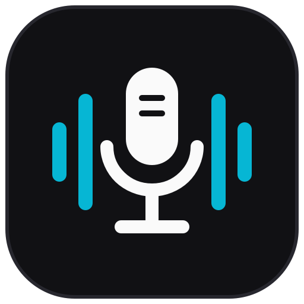
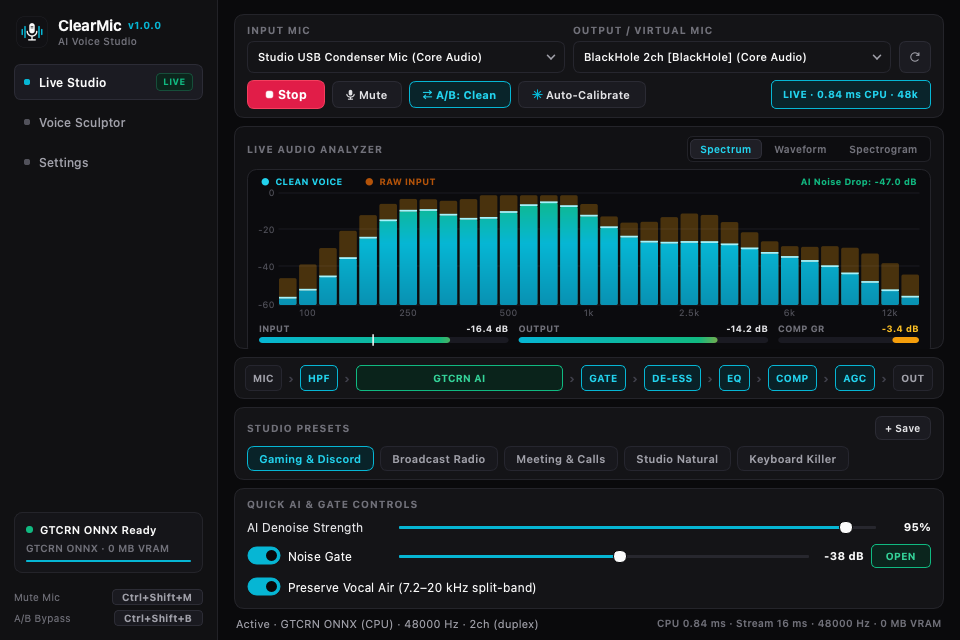
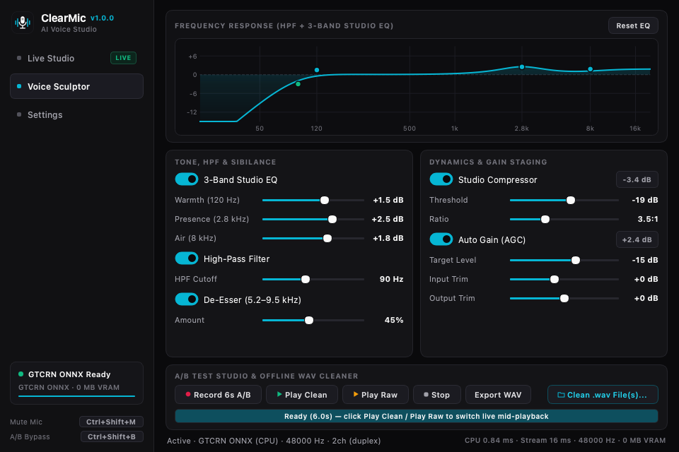
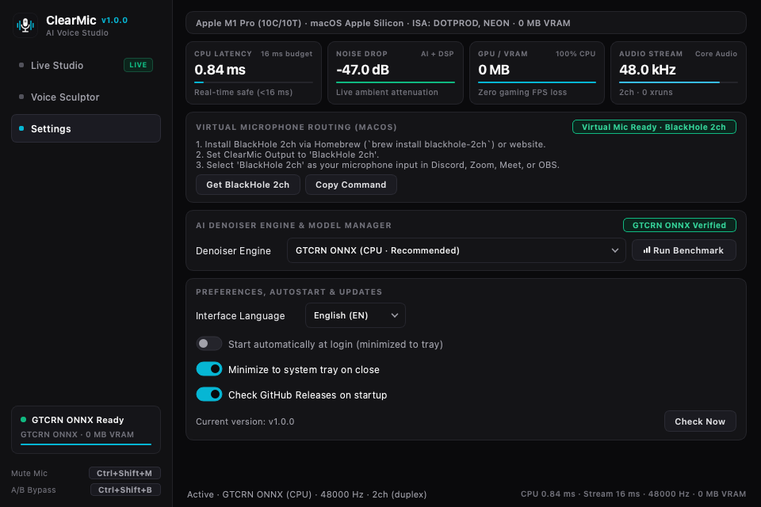
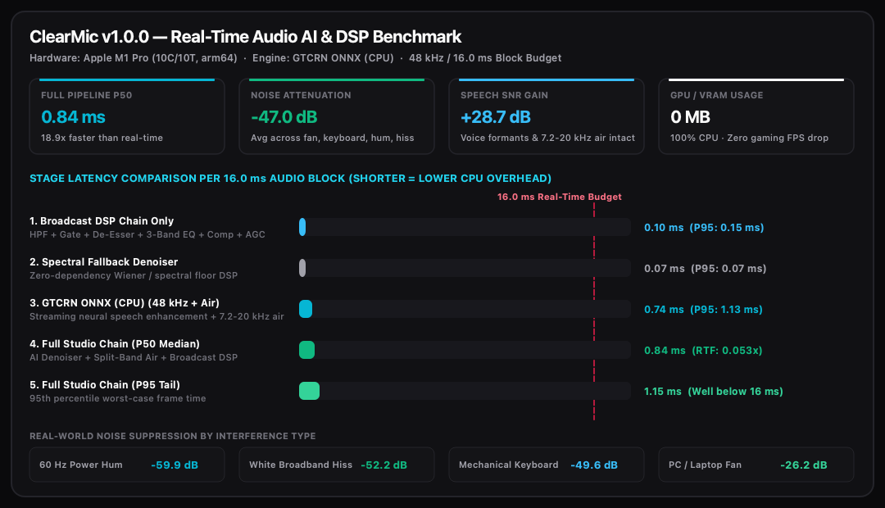
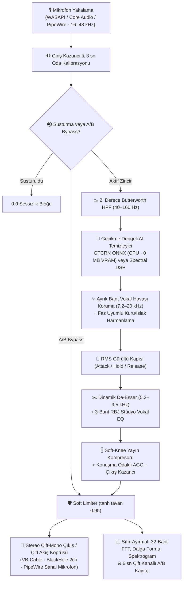

<div align="center">



# 🎙️ ClearMic — Çevrimdışı Yapay Zeka Mikrofon Gürültü Engelleyici & Yayın Ses Stüdyosu

**🇬🇧 [English README](README.md)** · **🇹🇷 Türkçe (Aktif)** · **[🎧 Uyumluluk Matrisi](COMPATIBILITY.md)** · **[🤝 Katkıda Bulun](CONTRIBUTING.md)** · **[🛡️ Güvenlik](SECURITY.md)** · **[📜 Değişiklik Günlüğü](CHANGELOG.md)**

**%100 çevrimdışı, 0 MB VRAM, ultra düşük gecikmeli (`16 ms` blok başına `0.85 ms` CPU) yapay zeka mikrofon gürültü engelleyici ve yayın ses stüdyosu — akışlı `GTCRN ONNX`, ayrık bant `7.2–20 kHz` vokal havası koruma, tam yayın DSP rafı, 3 sn oda kalibrasyonu ve çevrimdışı toplu `.wav` temizleyici ile Windows x64, macOS Apple Silicon ve Linux yerel desteği.**

[](https://clearmic.andacbasaran.com)
[-2563EB?style=for-the-badge&logo=windows&logoColor=white)](https://clearmic.andacbasaran.com/downloads/ClearMic.exe)
[-18181B?style=for-the-badge&logo=apple&logoColor=white)](https://clearmic.andacbasaran.com/downloads/ClearMic-macOS.dmg)
[-E95420?style=for-the-badge&logo=linux&logoColor=white)](https://clearmic.andacbasaran.com/downloads/ClearMic-Linux.tar.gz)
[](https://github.com/Andacbasaran/ClearMic/releases/latest)

[](https://github.com/Andacbasaran/ClearMic/actions/workflows/ci.yml)
[](https://github.com/Andacbasaran/ClearMic/releases/latest)
[](https://github.com/Andacbasaran/ClearMic/releases)
[](https://github.com/Andacbasaran/ClearMic/stargazers)
[](https://www.python.org/)
[-41CD52?style=flat-square&logo=qt&logoColor=white)](https://pypi.org/project/PyQt6/)
[-06B6D4?style=flat-square)](https://github.com/k2-fsa/sherpa-onnx)
[-10B981?style=flat-square)](#)
[](LICENSE)

<br/>

[**✨ Neden ClearMic?**](#-neden-clearmic-v100-studio-20) · [**🖥️ Arayüz**](#️-uygulama-arayüzü-studio-20) · [**⚖️ Karşılaştırma**](#️-alternatiflerle-karşılaştırma) · [**🚀 İndirme & Kurulum**](#-indirme-ve-kurulum) · [**🎛️ Kullanım & Kısayollar**](#️-kullanım-akışı-ve-kısayollar) · [**📊 Benchmark**](#-performans-testleri-ve-benchmark) · [**🧠 Sistem Mimarisi**](#-sistem-mimarisi) · [**📂 Dizin Yapısı**](#-proje-dizin-yapısı) · [**🗺️ Yol Haritası**](#️-yol-haritası-roadmap)

</div>

---

## ✨ Neden ClearMic? (v1.0.0 Studio 2.0)

**ClearMic**, herhangi bir dizüstü, USB, kulaklık veya XLR mikrofonu **Discord**, **OBS Studio**, **Zoom**, **Microsoft Teams**, **Google Meet** ve **oyun içi sesli sohbetler** için stüdyo kalitesinde bir yayın zincirine dönüştürür — mekanik klavye tıkırtılarını, PC/laptop fan uğultusunu, 60 Hz şebeke dip sesini ve arka plan tıslamasını **%100 işlemci üzerinde (`0 MB VRAM`)** ve **abonelik olmadan** gerçek zamanlı temizler.

<table>
  <tr>
    <td width="50%">
      <b>🧠 Akışlı GTCRN ONNX + 7.2–20 kHz Vokal Havası (0 MB VRAM)</b><br/>
      Yalnızca <code>~520 KB</code> boyutundaki sinir ağı modeli <code>16 ms</code> ses bloğu başına <b><code>0.85 ms</code> P50 CPU</b> süresinde (<b>18.9× gerçek zamanlı pay</b>) çalışır; gecikme dengeli kuru/ıslak harmanlama, ayrık bant <code>7.2–20 kHz</code> parlaklık koruması ve anında çalışan <b>Spectral DSP</b> yedeği sunar.
    </td>
    <td width="50%">
      <b>🎚️ Tam Yayın DSP Rafı &amp; Canlı Frekans Eğrisi</b><br/>
      Tıklanabilir <b>Sinyal Zinciri Şeridi</b> (<code>MIC › HPF › GTCRN AI › GATE › DE-ESS › EQ › COMP › AGC › OUT</code>), canlı QPainter <b>EQ + HPF eğrisi</b>, 5 hazır stüdyo profili (<i>Klavye Kesici</i> dahil) ve özel kullanıcı profilleriyle sesinizi şekillendirin.
    </td>
  </tr>
  <tr>
    <td width="50%">
      <b>🔌 Çapraz Platform Sanal Mikrofon &amp; Çift Akış Köprüsü</b><br/>
      <b>Windows (VB-Cable)</b>, <b>macOS (BlackHole 2ch)</b> ve <b>Linux (tek tık PipeWire/PulseAudio sanal mikrofon)</b> yerel desteği; otomatik stereo çift-mono çıkış, uyarlanabilir <code>48 / 44.1 / 32 / 16 kHz</code> yeniden örnekleme ve farklı Host API'ler arası köprüleme.
    </td>
    <td width="50%">
      <b>📊 3 Modlu Canlı Analizör &amp; 3 sn Oda Kalibrasyonu</b><br/>
      <b>32-Bant FFT Spektrum</b> (peak-hold destekli), <b>Tepe Zarfı Dalga Formu</b> veya <b>Canlı Spektrogram Şelalesi</b> ile ham/temiz sesi anlık izleyin; tek tıkla 3 saniyede odanızın taban gürültüsünü ölçüp Kapı, HPF ve AI gücünü otomatik ayarlayın.
    </td>
  </tr>
  <tr>
    <td width="50%">
      <b>🔬 6 sn Canlı A/B Test Stüdyosu &amp; Çevrimdışı Toplu <code>.wav</code> Temizleyici</b><br/>
      6 saniyelik eşzamanlı Ham + Temiz kayıt alıp oynatma sırasında tıklamasız 128-örnek crossfade ile anlık geçiş yapın, <code>.wav</code> dışa aktarın veya mevcut mono/stereo <code>.wav</code> kayıtlarınızı 18×+ hızda topluca temizleyin.
    </td>
    <td width="50%">
      <b>🔒 %100 Gizli, Çift Dilli (TR/EN) &amp; Sistem Tepsisi</b><br/>
      Sıfır bulut çağrısı, sıfır hesap, sıfır telemetri. Durum renkli sistem tepsisi simgesi, oturum açılışında otomatik başlatma (<code>--minimized</code>), tek örnek pencere odaklama ve SHA-256 doğrulamalı GitHub Releases güncelleyicisi ile sessizce çalışır.
    </td>
  </tr>
</table>

---

## 🖥️ Uygulama Arayüzü (Studio 2.0)

<div align="center">
  
</div>

<details>
<summary><b>📸 Diğer Ekranları Görüntüle (2. Sekme — Ses İşleyici &amp; A/B Test Lab · 3. Sekme — Ayarlar &amp; Canlı Telemetri)</b></summary>
<br/>
<div align="center">
  <p><b>2. Sekme — Ses İşleyici (Canlı HPF + 3-Bant EQ Eğrisi · De-Esser · Kompresör · AGC · 6 sn A/B Lab &amp; Toplu WAV Temizleyici)</b></p>
  
  <br/><br/>
  <p><b>3. Sekme — Ayarlar &amp; Telemetri (4'lü KPI Şeridi · İşletim Sistemine Özel Sanal Mikrofon Rehberi · Benchmark · TR/EN &amp; Güncelleyici)</b></p>
  
</div>
</details>

---

## ⚖️ Alternatiflerle Karşılaştırma

| Kriter | 🎙️ ClearMic v1.0.0 | Krisp | NVIDIA Broadcast | RNNoise *(OBS / Eklenti)* |
| :--- | :---: | :---: | :---: | :---: |
| **Ücret & Lisans** | **%100 Ücretsiz & Açık Kaynak (MIT)** | Ücretli abonelik *(günlük 60 dk sınır)* | Ücretsiz *(NVIDIA RTX GPU şart)* | Ücretsiz & Açık Kaynak (BSD) |
| **Ekran Kartı (VRAM) Kullanımı** | **`0 MB VRAM`** *(%100 CPU · `0.85 ms` P50)* | CPU *(kapalı kaynak)* | **`600 MB – 1.8 GB VRAM`** *(RTX Tensor)* | `0 MB VRAM` *(CPU)* |
| **%100 Çevrimdışı & Hesapsız** | **Evet** *(giriş yok, telemetri yok)* | Hesap & bulut lisans kontrolü | Çevrimdışı *(kapalı kaynak)* | Evet |
| **Platform Desteği** | **Windows x64 · macOS M1–M4 · Linux x64** | Windows · macOS | Yalnızca Windows *(RTX 2060+)* | Çapraz platform *(yalnızca eklenti)* |
| **Vokal Havası Koruma (`7.2–20 kHz`)** | **Evet** *(ayrık bant konuşma kapılı)* | Kapalı | Kapalı | Hayır *(boğuk tiz kesimi)* |
| **Tam Yayın DSP Zinciri** | **HPF + Kapı + De-Esser + 3-Bant EQ + Komp + AGC** | Sadece gürültü/yankı | Sadece gürültü/oda yankısı | Yalnızca gürültü kapısı |
| **3 sn Oda Kalibrasyonu & A/B Lab** | **Evet** *(canlı A/B geçiş + Toplu `.wav`)* | Basit mikrofon testi | Basit mikrofon testi | Yok |
| **Canlı Spektrum / Spektrogram UI** | **32-Bant FFT + Dalga + Spektrogram + EQ Eğrisi** | Minimal tepsi düğmesi | Temel kaydırıcı | OBS / DAW arayüzüne bağlı |

---

## 🚀 İndirme ve Kurulum

### Windows (x64 — Windows 10 / 11)
- **Kurulum Dosyası (Önerilen):** Resmi web sitesinden [**ClearMic.exe**](https://clearmic.andacbasaran.com/downloads/ClearMic.exe) (`ClearMic-Setup-v1.0.0-Windows-x64.exe`) dosyasını veya [GitHub Releases](https://github.com/Andacbasaran/ClearMic/releases/latest) sayfasından indirin.
- **Taşınabilir Arşiv (Kurulumsuz):** [GitHub Releases](https://github.com/Andacbasaran/ClearMic/releases/latest) üzerinden `ClearMic-Portable-v1.0.0-Windows-x64.zip` paketini indirebilirsiniz.
- **Paket Yöneticileri:** Winget ve Scoop manifestleri [`packaging/winget/`](packaging/winget/) ve [`packaging/scoop/`](packaging/scoop/) klasörlerinde bulunur.
- **Sanal Mikrofon Kurulumu (VB-Cable):**
  1. [**VB-Audio Virtual Cable**](https://vb-audio.com/Cable/) sürücüsünü kurun (veya `winget install VB-Audio.VB-Cable` çalıştırın).
  2. ClearMic **Canlı Stüdyo** sekmesinde **Çıkış** olarak `CABLE Input (VB-Audio Virtual Cable)` seçip **Başlat**'a tıklayın.
  3. Discord, Zoom, Teams veya OBS mikrofon ayarında `CABLE Output (VB-Audio Virtual Cable)` cihazını seçin.

### macOS (Apple Silicon M1–M4)
- **Yerel DMG (Önerilen):** [**ClearMic-macOS.dmg**](https://clearmic.andacbasaran.com/downloads/ClearMic-macOS.dmg) (`ClearMic-v1.0.0-macOS-arm64.dmg`) paketini indirin, **ClearMic.app** uygulamasını `Applications` klasörüne sürükleyin ve açın.
- **Homebrew Cask:** Formül [`packaging/homebrew/clearmic.rb`](packaging/homebrew/clearmic.rb) dosyasında yer alır.
- *İlk açılış notu:* ClearMic açık kaynaklı ad-hoc imzalıdır. İlk açılışta sağ tık → **Aç** seçin (veya terminalde `xattr -cr "/Applications/ClearMic.app"` çalıştırın) ve istendiğinde **Mikrofon** iznini onaylayın.
- **Sanal Mikrofon Kurulumu (BlackHole 2ch):**
  1. Homebrew ile [**BlackHole 2ch**](https://existential.audio/blackhole/) kurun: `brew install blackhole-2ch`.
  2. ClearMic **Çıkış** cihazını `BlackHole 2ch` yapın ve **Başlat**'a tıklayın.
  3. Discord, Zoom, Meet veya OBS mikrofon girişi olarak `BlackHole 2ch` seçin.

### Linux (`x86_64` — Ubuntu, Fedora, Arch, SteamOS)
- **Hazır Linux Paketi (Önerilen):** [**ClearMic-Linux.tar.gz**](https://clearmic.andacbasaran.com/downloads/ClearMic-Linux.tar.gz) (`ClearMic-v1.0.0-Linux-x86_64.tar.gz`) arşivini indirin, çıkartın ve `./ClearMic/ClearMic` ile başlatın.
- **Sanal Mikrofon Kurulumu (PipeWire / PulseAudio — Ek Sürücüsüz):**
  1. ClearMic → **Ayarlar** → **Sanal Mikrofon Oluştur** düğmesine tıklayın (`pactl` ile `ClearMic_Virtual_Output` ve `ClearMic_Virtual_Mic` otomatik oluşur) veya terminalden manuel ekleyin:
     ```bash
     pactl load-module module-null-sink sink_name=ClearMic_Virtual_Sink sink_properties=device.description="ClearMic_Virtual_Output"
     pactl load-module module-remap-source master=ClearMic_Virtual_Sink.monitor source_name=ClearMic_Virtual_Mic source_properties=device.description="ClearMic_Virtual_Mic"
     ```
  2. ClearMic **Çıkış** olarak `ClearMic_Virtual_Output`, Discord / OBS / Zoom girişi olarak `ClearMic_Virtual_Mic` seçin.

### Kaynak Koddan Çalıştırma *(Geliştirici Kurulumu)*
```bash
git clone https://github.com/Andacbasaran/ClearMic.git
cd ClearMic

# Hızlı otomatik başlatıcı (Linux / macOS)
./scripts/start.sh

# Veya manuel sanal ortam (Windows / macOS / Linux)
python -m venv .venv
# Windows: .\.venv\Scripts\activate  |  Linux/macOS: source .venv/bin/activate
pip install -r requirements.txt
python main.py
```

---

## 🎛️ Kullanım Akışı ve Kısayollar

1. **Cihazları Seçin:** Fiziksel mikrofonunuzu **Giriş Mikrofonu**, sanal ses kablonuzu (`CABLE Input` / `BlackHole 2ch` / `ClearMic_Virtual_Output`) **Çıkış / Sanal Mikrofon** olarak seçin.
2. **Oda Kalibrasyonu & Profil Seçimi:** **Başlat**'a basın, **Oda Kalibrasyonu** ile 3 saniye sessiz kalıp ortam gürültünüze göre otomatik ayar yapın ve 5 hazır profilden birini (`Oyun & Discord`, `Yayın & Radyo`, `Toplantı & Görüşme`, `Doğal Stüdyo`, `Klavye Kesici`) seçin.
3. **Dinle & Yayına Geç:** **Sinyal Zinciri Şeridi** üzerinden aşamaları tek tıkla açıp kapatın, **6 sn A/B Test Stüdyosu** ile Temiz/Ham farkını kulaklığınızda dinleyin ve Discord / OBS / Zoom girişini sanal mikrofona bağlayın.

| Kısayol / Parametre | Aksiyon | Açıklama |
| :---: | :--- | :--- |
| **`Ctrl+Shift+M`** | 🔇 **Mikrofonu Sustur / Aç** | Çıkış ses akışını anında sıfırlar ve tepsi/stüdyo rozetini kırmızıya çevirir. |
| **`Ctrl+Shift+B`** | 🔁 **A/B Bypass (Temiz / Ham)** | AI+DSP zinciri ile ham mikrofon sesi arasında canlı anlık karşılaştırma yapar. |
| **`--minimized`** | 📥 **Sistem Tepsisinde Başlat** | Pencereyi gizli başlatır ve gürültü engellemeyi otomatik devreye alır (otomatik başlatma modu). |

---

## 📊 Performans Testleri ve Benchmark

**Apple M1 Pro (10C/10T, `arm64`, `Darwin 27.0.0`)** üzerinde **48 kHz / 768 örnek blok (`16.0 ms` gerçek zamanlı bütçe)** ile `GTCRN ONNX (CPU)` ve **0 MB VRAM** kullanılarak ölçülmüştür.

<div align="center">
  
</div>

### Aşama Gecikmeleri ve Gerçek Zamanlı Pay (`48 kHz` · `16.0 ms` Blok Bütçesi)

| Pipeline Aşaması | P50 Gecikme | P95 Gecikme | Açıklama |
| :--- | :---: | :---: | :--- |
| **1. Yalnızca Yayın DSP Zinciri** | **`0.102 ms`** | `0.154 ms` | HPF + Gürültü Kapısı + De-Esser + 3-Bant EQ + Kompresör + AGC + Soft Limiter |
| **2. Spectral Yedek Temizleyici** | **`0.070 ms`** | `0.074 ms` | Sıfır bağımlılık Wiener / spektral taban CPU yedek motoru |
| **3. GTCRN ONNX AI (`48 kHz` + Hava)** | **`0.737 ms`** | `1.131 ms` | Akışlı sinir ağı + durumlu 3× yeniden örnekleyici + `7.2–20 kHz` hava bandı |
| **4. Tam Stüdyo Zinciri (Uçtan Uca)** | **`0.845 ms`** | **`1.151 ms`** | **RTF `0.0528×`** (**gerçek zamandan `18.9×` hızlı**), **`0 MB VRAM`** |

### Gerçek Dünya Gürültü Bastırma & Konuşma Koruma Sonuçları

| Test Sinyali / Gürültü Profili | Ölçülen Sonuç | Açıklama |
| :--- | :---: | :--- |
| **60 Hz Şebeke Uğultusu + Harmonikler** | **`-59.9 dB`** | HPF + GTCRN ONNX ile tamamen temizlenir |
| **Geniş Bant Beyaz Tıslama (Hiss)** | **`-52.2 dB`** | Dijital bozulma olmadan derin taban temizliği |
| **Mekanik Klavye Tıkırtıları** | **`-49.6 dB`** | Keskin 6 ms tuş darbelerini gerçek zamanlı bastırır |
| **PC / Laptop Fan Uğultusu** | **`-26.2 dB`** | Düşük-orta frekanslı fan ve hava akışı uğultusunu azaltır |
| **4 Profil Ortalama Gürültü Düşüşü** | **`-47.0 dB`** | Tüm gürültü tipleri genelinde ortalama bastırma |
| **Gürültülü Konuşma SNR Kazancı** | **`+28.7 dB`** | Çoklu formantlı vokal ve `7.2–20 kHz` parlaklık korunur |

Kendi donanımınızda benchmark ve test paketini çalıştırın:
```bash
# Gerçek zamanlı benchmark çalıştır & benchmark_results.json oluştur
QT_QPA_PLATFORM=offscreen python scripts/benchmark.py

# Tüm birim ve headless Studio UI testlerini çalıştır
QT_QPA_PLATFORM=offscreen pytest -v
```

---

## 🧠 Sistem Mimarisi



---

## 📂 Proje Dizin Yapısı

```text
├── main.py & run.py                     # Kök giriş noktaları (kaynak kod & PyInstaller)
├── clearmic/                            # Çekirdek Python paketi (v1.0.0)
│   ├── __init__.py                      # Sürüm, uygulama üstverisi ve paket kimlikleri
│   ├── main.py                          # Fusion QApplication, QLocalServer tek örnek kilidi & crash günlüğü
│   ├── config.py                        # Atomik işletim sistemine özel JSON yapılandırma kaydı
│   ├── presets.py                       # 5 hazır Stüdyo profili + özel kullanıcı profili yöneticisi
│   ├── hardware.py                      # Çapraz platform CPU/ISA algılama, yazı tipleri ve yazılabilir OS dizinleri
│   ├── i18n.py                          # Çift dilli EN / TR LanguageManager
│   ├── updater.py                       # Çapraz platform GitHub Releases SemVer güncelleyici (SHA-256 doğrulamalı)
│   ├── audio/
│   │   ├── denoiser.py                  # GTCRN ONNX CPU, gecikme dengeli harmanlama, 7.2-20 kHz hava, yeniden örnekleyici & Spectral DSP
│   │   ├── dsp.py                       # HPF, NoiseGate, DeEsser, 3-Bant EQ, EQ eğrisi matematiği, Kompresör, AGC, Limiter
│   │   ├── engine.py                    # AudioEngine v2: stereo anlaşma, Host API köprüsü, FFT analizörü & Oda Kalibrasyonu
│   │   ├── devices.py                   # OS Host API sıralama, sanal mikrofon algılama & tek tık Linux pactl kurulumu
│   │   ├── file_processor.py            # Çevrimdışı tekli & toplu .wav temizleyici (mono/stereo, int16/int32/float32)
│   │   ├── model_manager.py             # Model keşfi, certifi SSL atomik indirme & SHA-256 doğrulama
│   │   └── recorder.py                  # 6 sn çift kanallı A/B kayıtçı, canlı crossfade geçişi & WAV dışa aktarım
│   ├── system/
│   │   └── startup.py                   # Windows Kayıt Defteri, macOS LaunchAgent & Linux XDG otomatik başlatma
│   └── ui/
│       ├── main_window.py               # Studio 2.0 3 sekmeli masaüstü arayüzü (Canlı Stüdyo, Ses İşleyici, Ayarlar)
│       ├── waveform_widget.py           # 32-Bant FFT Spektrum (peak-hold), Dalga Formu, Spektrogram & üçlü dB ölçer
│       ├── widgets.py                   # SignalChainStrip, EQCurveWidget, TelemetryCard, FlatSwitch & HiDPI ikonlar
│       ├── styles.py                    # Mat Studio Obsidian + Electric Cyan QSS teması
│       └── tray.py                      # Çapraz platform durum renkli sistem tepsisi simgesi & menüsü
├── tests/                               # Pytest birim, cihaz/motor, platform & headless Qt Studio UI test paketleri
├── scripts/                             # benchmark.py, build_exe.py, build_macos.py, build_linux.py, start.sh, baslat.bat
├── packaging/                           # Inno Setup (installer.iss), Winget, Scoop, Homebrew Cask, Linux AppRun/desktop, SignPath
├── assets/                              # Obsidian + Cyan ikonlar (.svg/.png/.ico/.icns), UI ekran görüntüleri & benchmark grafiği
└── .github/workflows/                   # 3-OS CI matrisi (ci.yml) & birleşik 3-platform Release hattı (release.yml)
```

---

## 🗺️ Yol Haritası (Roadmap)

- [x] **Studio 2.0 Yeniden Tasarım, Tıklanabilir Sinyal Zinciri & Canlı EQ Eğrisi** — v1.0.0 ile yayınlandı.
- [x] **Gecikme Dengeli GTCRN ONNX + Ayrık Bant `7.2–20 kHz` Vokal Havası Koruma** — v1.0.0 ile yayınlandı.
- [x] **Çapraz Platform Sanal Mikrofon Desteği (Windows VB-Cable, macOS BlackHole, Linux PipeWire)** — v1.0.0 ile yayınlandı.
- [x] **3 sn Oda Kalibrasyonu, Canlı A/B Crossfade & Çevrimdışı Toplu `.wav` Temizleyici** — v1.0.0 ile yayınlandı.
- [x] **Çift Dilli TR / EN Arayüz & Birleşik 3-Platform GitHub Releases Hattı** — v1.0.0 ile yayınlandı.
- [ ] **Sistem Geneli Global Kısayollar (OS Hook)** — Tam ekran oyunlarda tepsideyken bile `Ctrl+Shift+M` / `Ctrl+Shift+B` tetikleme.
- [ ] **Uygulama Bazlı Ses Profilleri** — OBS açıldığında otomatik *Yayın & Radyo*, Discord açıldığında *Oyun & Discord* profiline geçiş.
- [ ] **Linux AppImage / Flatpak & VST3 / AU Eklenti Köprüsü** — Sanal kablo olmadan doğrudan DAW ve OBS entegrasyonu.

---

## 🤝 Katkıda Bulunma, Ekosistem & Lisans

Katkılarınız, mikrofon/ses kartı uyumluluk bildirimleriniz, DSP iyileştirmeleriniz ve çevirileriniz her zaman değerlidir!
- Geliştirme ortamı kurulumu için [CONTRIBUTING.md](CONTRIBUTING.md) dosyasını okuyun.
- Test ettiğiniz mikrofon, ses arayüzü veya uygulamaları [COMPATIBILITY.md](COMPATIBILITY.md) matrisine ekleyin.
- %100 çevrimdışı ses gizliliği garantileri ve SHA-256 doğrulama adımları için [SECURITY.md](SECURITY.md) dosyasını inceleyin.

### 🧩 Çevrimdışı Masaüstü Yapay Zeka Ekosistemi
**Andaç Başaran** tarafından geliştirilen diğer %100 çevrimdışı, 0 MB VRAM açık kaynaklı masaüstü araçları keşfedin:
- **[⚡ SubVision AI](https://github.com/Andacbasaran/subvision-ai-subtitle-translator)** — PC oyunları, diziler, filmler ve canlı yayınlar için gerçek zamanlı (~88 ms), %100 çevrimdışı ekran üstü ve canlı ses altyazı stüdyosu.
- **[🎙️ LocalDictate](https://github.com/Andacbasaran/LocalDictate)** — `faster-whisper` INT8, uygulamaya duyarlı yönlendirme ve dinamik parçacıklarla ultra düşük gecikmeli çevrimdışı sesten yazıya dikte stüdyosu.
- **[📝 LocalMinutes](https://github.com/Andacbasaran/LocalMinutes)** — Çift kanallı yakalama, konuşmacı takibi ve yerel özetleme sunan toplantıya bot sokmayan çevrimdışı deşifre stüdyosu.
- **[🧠 LocalRecall](https://github.com/Andacbasaran/LocalRecall)** — Gizlilik öncelikli, 0 MB VRAM yerel ekran hafızası ve hibrit FTS5/OCR görsel arama (açık kaynak Windows Recall alternatifi).

**ClearMic** sesli görüşmelerinizi, yayınlarınızı veya kayıtlarınızı iyileştiriyorsa GitHub'da **⭐ Star** vererek destek olabilirsiniz!

Bu proje **[MIT License](LICENSE)** kapsamında açık kaynak olarak lisanslanmıştır.
